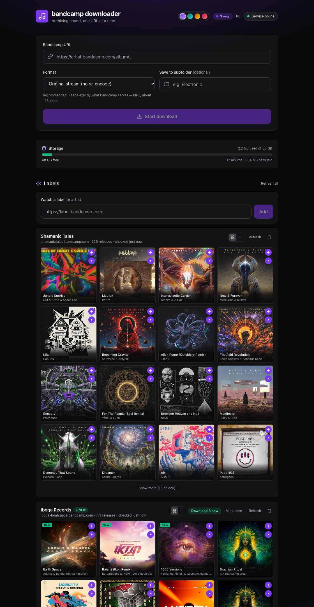

# Bandcamp Downloader

A small self-hosted web app for archiving Bandcamp music. Built to run in a
lightweight Proxmox LXC container, no external services required.

Current version: **1.2** — see [CHANGELOG.md](CHANGELOG.md).



*New download form with format picker, storage panel, the new-release ticker,
two watched labels and the library.*

## What it does

- Paste a Bandcamp album, track or artist URL and it downloads to disk.
- Downloads queue two at a time, with progress, speed, ETA, cancel and retry.
- Tags are written from Bandcamp metadata and cover art is embedded.
- Tracks land as `Artist - Album/1 - Track.mp3`. Compilations use the album
  artist, so one release stays in one folder.
- A library browser lists everything already downloaded, with artwork, track
  count, runtime and size.
- Download an album from the browser as a single zip, instead of saving tracks
  one at a time.
- Albums and individual tracks can be deleted from the browser (two clicks:
  arm, then confirm).
- A storage panel shows disk used, disk free and the size of your music.
- A label watch lists a label's or artist's catalogue as a compact cover grid
  (or a list with thumbnails), with a plus button to queue any release and a
  "new" badge on releases that appeared since the last check.
- A web player streams a **preview** of any release in the browser. The Bandcamp
  CDN stream goes straight to the audio element, nothing is written to disk.
  Track list, seek, prev/next and media-session support included.
- Four colour themes and an English/Polish toggle, both remembered per browser.

## Interface

**Themes.** Violet, Teal, Amber and Rose. The layout is a neutral near-black
surface; the theme only changes the accent hue, which drives the logo, buttons,
links, focus rings, progress bars, chips and the glow behind the header. The tab
favicon follows the accent too. The choice lives in `localStorage`, so each
browser keeps its own.

**Language.** EN and PL switch every label, button and empty state in the UI.
Also stored per browser.

**New-release ticker.** When watched labels have releases you have not seen yet,
a pulsing count appears in the header. It reads from the same state as the
per-label "New" badges, so it needs no extra request.

**Keyboard.** With the player open: `Space` toggles playback, `←`/`→` seek ten
seconds, `Esc` closes the player. Key presses inside form fields and on buttons
are left alone.

## Queue and formats

Every task shows artist, "track 3 of 9", transfer speed and time left, then ends
as completed, failed or cancelled. Failed tasks can be retried, finished ones
dismissed, and a completed task links straight to its album in the library.

Bandcamp's free streams are **MP3 at roughly 128 kbps**. Purchased downloads are
FLAC, and those come from your account, not from this app.

So the format selector is honest about what it can do:

| Option | What actually happens |
| --- | --- |
| Original stream | Keeps the source untouched. This is the one you want. |
| MP3 320 kbps | No effect. The source is already MP3, so it is copied as-is. |
| FLAC | Decodes the MP3 into a lossless container. ~13x bigger, identical audio. |
| AAC / M4A | Re-encodes. Smaller, and lossier than the source. |
| WAV | Uncompressed. Very large, no cover art. |

If you want real lossless, buy the album on Bandcamp and download it from your
account.

## Cookies and paid downloads

If a Netscape-format cookie file exists at `DATA/cookies/cookies.txt`, it is
passed to yt-dlp, so a logged-in account can reach whatever that account is
entitled to. The app never touches the account, it only forwards the cookie jar:

```bash
# inside the container, as root
install -d -o bandcamp -g bandcamp /opt/bandcamp-downloader/data/cookies
# paste the cookie jar exported from your browser into cookies.txt
systemctl restart bandcamp-dl
```

Two limits worth knowing:

- Owning an album, not being logged in, is what unlocks FLAC. Bandcamp checks
  the purchase server-side, so a cookie file alone will not upgrade a release
  you never bought.
- yt-dlp impersonates Chrome (`chrome-133:macos-15` via `curl_cffi`) because
  Bandcamp's bot checks reject a bare Python user agent. No headless browser is
  involved.

## Library

Everything under `DOWNLOAD_ROOT` is listed newest first. Expanding an album shows
each track with bitrate, duration and size, and a **Save** link for the track on
its own.

- **Download** on an album row packs the whole folder, tracks and cover, into one
  zip named after the album. One request, one file.
- **Delete** takes two clicks: the first arms the button, the second confirms.
  Deleting an album removes the folder and everything in it.
- Cover art is embedded in the audio by Bandcamp, so the first scan extracts it
  once into `cover.jpg` in the album folder and the browser reuses it.
- Bitrate and duration are probed server-side with mutagen and cached against the
  file's mtime and size, so rescanning a large library is cheap.

## Label watch

Paste `https://some-label.bandcamp.com` (or just `some-label.bandcamp.com`) into
the Labels box. The app reads the release grid from the label's `/music` page and
stores the result in `data/labels.json`.

- The first sync marks everything as already seen, so adding a label with 200
  releases does not flag all 200 as new.
- Releases added later are badged **New**, with a `Download N new` button and a
  `Mark seen` control that clears the badge without downloading.
- 16 releases are shown at a time; `Show more` pages through the rest in steps
  of 16. The grid/list switch is per label and remembered for the session.
- Labels can be refreshed one at a time or all at once, and removed without
  touching anything on disk.
- The page also refreshes automatically on load when the stored data is more
  than six hours old.
- A background worker re-checks every watched label on a timer
  (`CHECK_INTERVAL`, default six hours) so the catalogue stays current while the
  page is closed. Set `AUTO_DOWNLOAD=true` and it also queues anything new,
  instead of only badging it.

## Maintenance

`tools/tidy_library.py` fixes up a library downloaded by older versions:

```bash
python3 tools/tidy_library.py --root /opt/bandcamp-downloader/downloads \
                             --trash /root/removed --apply
```

It strips the duplicated artist prefix from filenames, moves `.flac` transcodes
that have an identical `.mp3` twin into the trash folder, and renames stray
artwork to `cover.jpg`. Without `--apply` it only prints the plan.

## Install (Proxmox LXC)

1. Create a container: Debian 12 or Ubuntu 24.04, 1 vCPU, 1 GB RAM, disk to taste.
2. Copy this folder in, then:

   ```bash
   sudo ./install.sh
   ```

3. The script prints the URL, username and password when it finishes.

It creates a `bandcamp` system user, installs ffmpeg, builds a virtualenv and
registers a sandboxed systemd unit. Re-running it keeps the existing password
and never touches your downloads.

The unit runs with `ProtectSystem=strict`, so `downloads/` and `data/` are the
only writable paths. Both must stay in `ReadWritePaths`, or label writes and
cover extraction start failing.

## Configuration

Everything is environment variables, set in the systemd unit:

| Variable | Default | Purpose |
| --- | --- | --- |
| `DOWNLOAD_ROOT` | `./downloads` | Where files are written |
| `STATE_DIR` | `./data` | Label list and the cookie jar |
| `APP_USERNAME` / `APP_PASSWORD` | `bandcamp` / unset | HTTP basic auth. Unset means no auth and localhost-only binding when run directly |
| `MAX_CONCURRENT_DOWNLOADS` | `2` | Parallel downloads. Keep low on small containers |
| `MAX_TASKS` | `100` | Finished tasks kept in memory |
| `TASK_RETENTION_HOURS` | `24` | How long finished tasks stay listed |
| `CHECK_INTERVAL` | `21600` | Seconds between background label checks |
| `AUTO_DOWNLOAD` | `false` | Queue new label releases automatically |
| `HOST` | `0.0.0.0` | Listen address |
| `PORT` | `8000` | Listen port |

## Bind mounts (optional)

To keep music on a NAS or ZFS pool, map the downloads directory from the host:

```bash
pct set <LXC_ID> -mp0 /mnt/pve/nas/music,mp=/opt/bandcamp-downloader/downloads
```

Make sure the mount is writable by the `bandcamp` user (uid of the service user
inside the container).

## Development

```bash
python3 -m venv venv
venv/bin/pip install -r requirements.txt
APP_PASSWORD=dev venv/bin/python app.py    # http://127.0.0.1:8000
```

The frontend assets are vendored: Alpine.js ships in `static/vendor`, there is no
CDN and no build step at runtime. If you edit `templates/index.html` and add
Tailwind classes, rebuild the stylesheet:

```bash
npx tailwindcss@3.4.17 -c tailwind.config.js -i assets/input.css -o static/app.css --minify
```

Theme colours are CSS variables defined once in `assets/input.css`. The markup
uses plain accent utilities (`bg-indigo-600`, `text-indigo-300`), and a small
block of overrides at the end of that file remaps them onto the active theme, so
adding a theme means adding one variable block and one picker entry.

## Security notes

- Only `*.bandcamp.com` URLs are accepted, and they must resolve to a public IP.
- The download subfolder cannot escape `DOWNLOAD_ROOT`.
- The systemd unit runs as an unprivileged user with `ProtectSystem=strict`.
- Basic auth is on by default. Put it behind a reverse proxy with TLS if you
  expose it beyond your LAN.

## Stack

Python 3, FastAPI, uvicorn, yt-dlp with `curl_cffi`, ffmpeg, mutagen. Frontend is
plain Alpine.js with a prebuilt Tailwind stylesheet.

## License

MIT. See [LICENSE](LICENSE).
